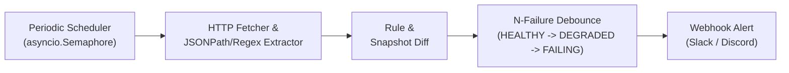

# driftwatch

외부 웹페이지나 공공, 파트너 JSON API의 주요 값(교통 요금, 막차 시각, 환율, 정책 수치)이 예고 없이 바뀌거나 스키마를 벗어나는지 주기적으로 수집해 검증하는 비동기 감시 엔진입니다. 새벽 점검이나 일시적 502/503 순단으로 인한 오탐 알림을 줄이기 위해 N회 연속 실패 디바운스(Debounce)를 거친 뒤에만 상태를 전이하고 웹훅 알림을 보냅니다.

## 수집 및 상태 전이 방식



### 추출과 단어 경계 검증 (`extractor.py`)
중첩 JSON 경로(`data.fare.adult`, `routes.0.id`)는 `jsonpath-ng`와 Pydantic `TypeAdapter`로 값과 타입을 검증합니다. 웹페이지 본문에서 `"15"`나 `"1400"` 같은 숫자를 단순 부분 문자열(`in`)로 찾으면 `"1500"`이나 `"21400"`에 걸려 오탐이 발생하므로, 앞뒤에 다른 숫자가 붙지 않은 경우(`(?<!\d)...(?!\d)`)만 매칭합니다.

### N회 연속 실패 디바운스 (`store.py`, `runner.py`)
1~2회 일시적 타임아웃이나 503 응답은 `DEGRADED` 상태로만 기록하고 웹훅을 보내지 않습니다. `failure_threshold`(기본 3회)에 연속으로 도달한 순간에만 `FAILING`으로 전이하고 알림을 1회 발행하며, 이후 점검이 성공하면 카운터를 0으로 되돌려 `HEALTHY`로 복구합니다. 직전 정상 스냅샷과 값이 달라지면 `VALUE_DRIFT`, 허용 범위(`min_value`, `max_value`)나 기대값(`expected_value`)을 벗어나면 `RULE_VIOLATION` 알림을 기록합니다.

### 동시성 제어와 모듈 구성
`asyncio.Semaphore`로 동시 HTTP 요청 수를 제한하고 웹훅 전송 실패는 `tenacity` 지수 백오프로 재시도합니다.

```text
driftwatch/
├── models.py      SQLAlchemy 2.0 비동기 ORM 모델 및 Pydantic v2 스키마
├── extractor.py   jsonpath-ng 중첩 경로 추출 및 숫자 단어 경계 정규식 파서
├── store.py       스냅샷 이력, 연속 실패 카운터, 상태 전이 원자적 저장소
├── runner.py      asyncio.Semaphore 동시 수집기, Diff 판정, tenacity 웹훅 발송기
├── app.py         FastAPI Lifespan 주기 스케줄러 및 REST/Prometheus 엔드포인트
└── cli.py         Typer 기반 CLI (init-db, serve, check)
tests/
└── test_driftwatch.py   추출기 경계, N회 디바운스 상태 전이, 동시성 및 E2E 검증
```

## 실행 방법 (CLI / FastAPI)

Python 3.11 이상 환경에서 `fastapi`, `uvicorn`, `pydantic`, `pydantic-settings`, `sqlalchemy`, `aiosqlite`, `httpx`, `jsonpath-ng`, `tenacity`, `prometheus-client`, `typer`를 사용합니다.

```bash
# SQLite 데이터베이스 초기화
python3 -m driftwatch.cli init-db --db sqlite:///driftwatch.db

# API 서버 및 백그라운드 수집기 실행 (30초 주기)
python3 -m driftwatch.cli serve --host 0.0.0.0 --port 8000 --db sqlite:///driftwatch.db --poll-interval 30
```

| CLI 명령어 | 설명 | 주요 옵션 |
|---|---|---|
| `driftwatch serve` | FastAPI HTTP 서버 및 주기 수집 루프 실행 | `--host`, `--port`, `--db`, `--poll-interval` |
| `driftwatch check` | 단일 또는 전체 대상 수동 점검 | `--db`, `--target-id`, `--all` |
| `driftwatch init-db` | 스키마 테이블 생성 | `--db` |

### 감시 대상 등록 및 수동 점검

```bash
curl -X POST http://localhost:8000/v1/targets \
  -H "Content-Type: application/json" \
  -d '{
    "target_id": "subway-base-fare",
    "name": "지하철 기본 요금",
    "url": "https://api.example.com/fare",
    "extractor_type": "json_path",
    "selector": "fare.adult",
    "expected_type": "int",
    "expected_value": "1400",
    "min_value": 1000,
    "max_value": 2000,
    "failure_threshold": 3,
    "interval_seconds": 60,
    "webhook_url": "https://hooks.slack.com/services/xxx/yyy/zzz"
  }'

# 즉시 점검 / 알림 이력 / Prometheus 메트릭
curl -X POST http://localhost:8000/v1/targets/subway-base-fare/check
curl http://localhost:8000/v1/alerts
curl http://localhost:8000/metrics
```

## 테스트 및 한계

```bash
ruff check driftwatch tests
mypy driftwatch tests
pytest -v tests/
```

`httpx.AsyncClient`로 HTML/JSON 응답 본문을 직접 가져오므로 브라우저에서 JavaScript가 실행된 뒤에야 DOM이 그려지는 SPA 페이지는 헤드리스 브라우저 프록시 없이 추출할 수 없습니다. 또한 FastAPI 인프로세스 루프가 주기를 실행하므로 다중 워커로 수평 확장할 때는 외부 스케줄러나 분산 락으로 중복 수집을 막아야 합니다.
